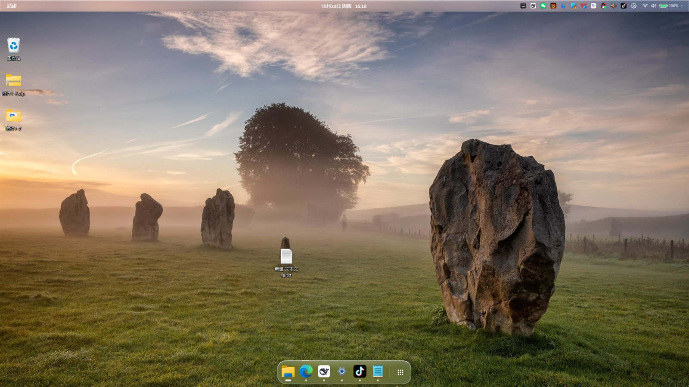
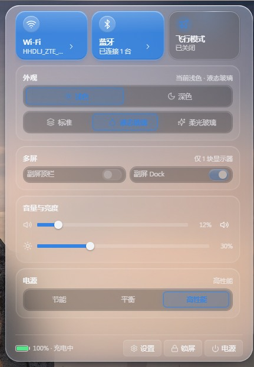
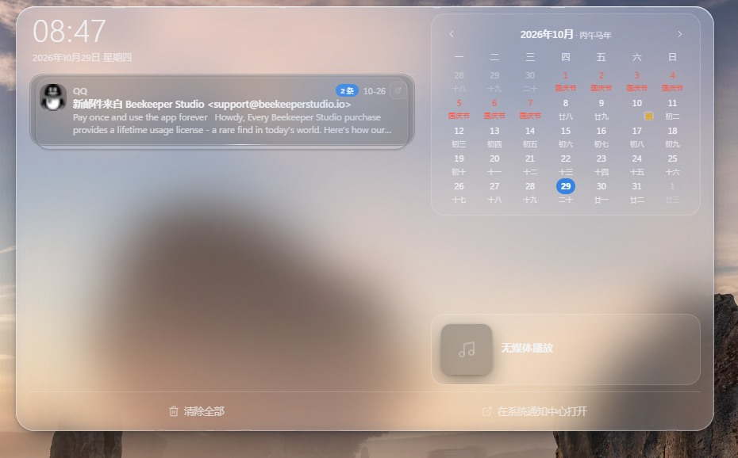
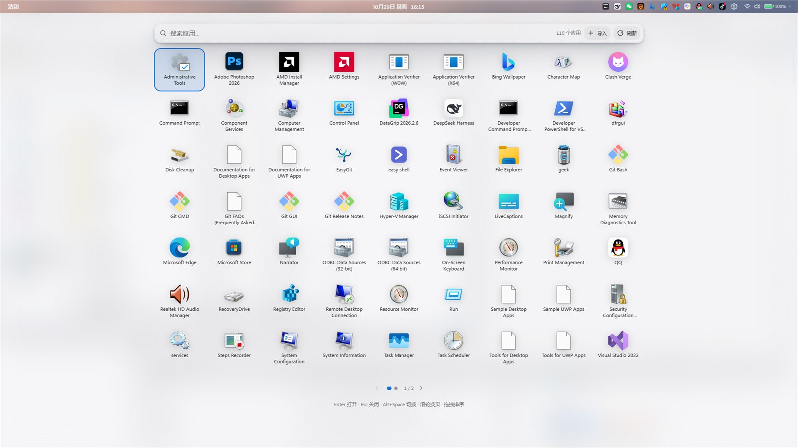
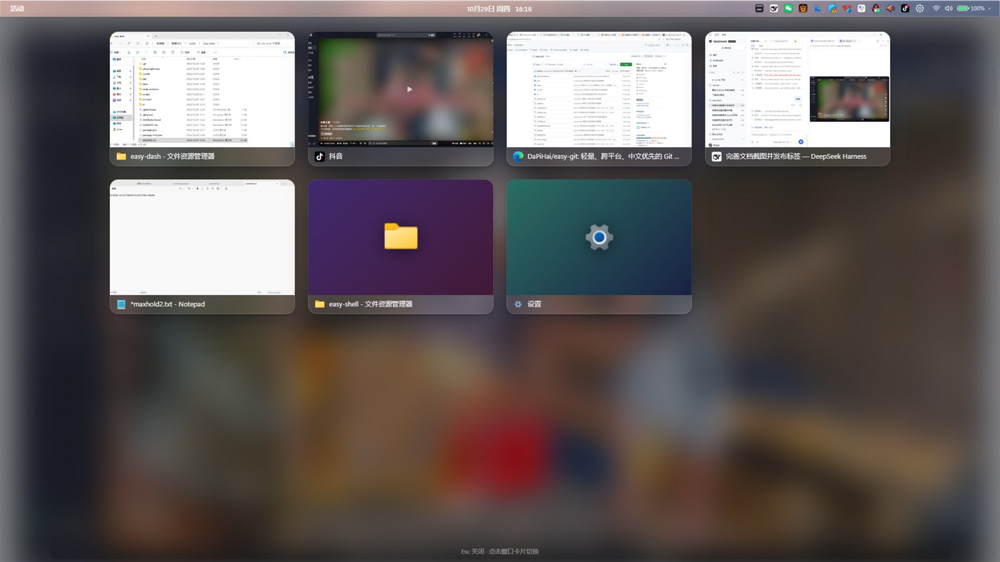
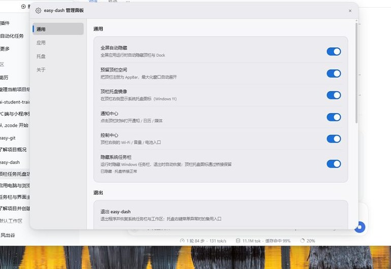

<div align="center">

# easy-dash

**给 Windows 换一套 GNOME 风格的桌面外壳：顶栏 · Dock · 应用中心 · 活动概览 · 控制中心 · 通知中心**

用 Tauri 2 + Rust 写系统能力，用原生 HTML/CSS/JS 写界面（无前端框架、无打包器）


[功能](#功能) · [快速开始](#快速开始) · [技术栈](#技术栈) · [文档索引](#文档索引) · [已知限制](#兼容性与已知限制)

</div>



## 这是什么

Windows 原生任务栏能干活，但不太好看：任务栏、开始菜单、通知中心、快捷设置各自一套视觉，彼此不统一。
**easy-dash** 用一套自绘的桌面外壳把它们替换掉：

- 屏幕顶部一条 **GNOME 风格顶栏**：活动按钮、时钟日期、系统托盘镜像、网络 / 音量 / 电池；
- 底部一条 **macOS 风格 Dock**：固定应用、运行指示点、悬停放大、右键菜单、九点格进应用中心；
- **控制中心 / 通知中心** 用 Apple 控制中心式的玻璃面板，接的是 Windows 真实的 Wi-Fi、蓝牙、音量、
  亮度、电源模式与通知历史；
- **活动概览** 实时缩略图切换窗口，**应用中心** 分页网格启动任何已安装应用；
- 主题（浅色 / 深色）× 材质（标准 / 液态玻璃 / 柔光玻璃）自由组合，动效按 iOS 手感调。

所有系统能力都是原生的：隐藏并接管任务栏与工作区、代理系统托盘图标、读取 Windows 通知数据库、
通过 Core Audio / DDC-CI / WLAN API / WinRT 控制硬件。**不是皮肤，是替换外壳。**

## 功能

### 顶栏（每块屏一条）

- 左「活动」按钮进活动概览，中间时钟点开通知中心，右侧状态区点开控制中心；
- 鼠标悬停音量图标 **滚动滚轮直接调音量**（顶栏内 OSD 显示百分比）；
- **系统托盘镜像**：真实 HICON 图标、随 `NIM_MODIFY` 实时更新、可拖拽排序，点击直达应用菜单；
- **桌面图标自动避让**：把 Explorer 桌面视图整体下移顶栏高度，第一行图标不再被顶栏盖住，退出时移回；
- 多显示器：默认每块屏一条顶栏（各自时钟、面板、托盘、全屏隐藏互不影响），可在控制中心关闭副屏顶栏。

### 控制中心 / 通知中心

| 控制中心 | 通知中心 |
| :-: | :-: |
|  |  |

- **控制中心**：Wi-Fi / 蓝牙 / 飞行模式磁贴（点图标开关，点其余区域进入连接列表）、外观两段切换、
  界面材质三段切换、滚轮 + 拖拽调音量与亮度、电源模式三档、多屏开关、设置 / 锁屏 / 睡眠 / 关机 / 重启 / 注销。
- **通知中心**：左栏大时钟 + 通知列表（按应用分组、多条堆叠、真实图标，点「打开应用」直达来源应用），
  右栏中文月历（**法定节假日「休 / 班」标记 + 农历干支生肖**）与 **SMTC 媒体播放控件**（封面 / 进度 / 上一首·下一首）。

### Dock 与应用中心



- Dock 固定应用 + 运行指示点，悬停放大，右键固定 / 取消固定，九点格按钮进应用中心；
- **智能隐藏**：普通窗口压到 Dock 区域时自动滑下，鼠标移到屏幕底边临时滑出（可在管理面板关闭）；
- 应用中心是全屏**分页**网格，汇集开始菜单经典应用与 WinRT 打包应用，滚轮 / 触控板 / PageUp·PageDown 换页，
  支持搜索、方向键导航、回车启动、**拖拽排序**、**导入自定义应用**（.exe/.lnk/.url）。

### 活动概览



全屏概览所有打开的窗口（打开时实时截图缩略图），点击切换、`Esc` 关闭，打开时遮罩淡入 + 卡片错峰入场。

### 管理面板

<p align="center"></p>

集中管理通用开关（全屏隐藏 / Dock 智能隐藏 / 顶栏预留 / 托盘镜像 / 通知中心 / 控制中心 / 隐藏系统任务栏）、
外观与材质、多屏、热键、Dock 固定应用、应用中心导入项、托盘顺序与版本信息。

### 主题与材质

- **主题**：浅色 / 深色两态，全部窗口同步切换、配置持久化、首帧无闪烁；开启「同时控制系统主题」后
  在控制中心切换会同步修改 Windows 主题。
- **材质**：`solid`（标准）/ `liquid`（液态玻璃）/ `glow`（柔光玻璃），与明暗主题正交。
  液态玻璃会**采样桌面壁纸**做 18–30px 模糊、150% 饱和与自适应对比度色阶，浅色模式下自动按背景亮度
  切换「浅色玻璃 + 深色字 / 深色玻璃 + 浅色字」。
- **动效**：iOS 手感的按压缩放、分段控件滑块、面板抽屉进出场、Dock 启动弹跳、鼠标流光（光标跟随的柔光与
  沿边框绕行的光带），全部遵守 `prefers-reduced-motion`。

## 快速开始

### 安装

1. 到 [Releases](https://github.com/DaPiHai/easy-dash/releases) 下载 `easy-dash_<version>_x64-setup.exe`；
2. 双击安装（默认当前用户，向导会请求管理员权限，用于接管任务栏与高权限窗口）；
3. 启动后顶栏、Dock 与系统托盘图标就位，配置写入 `%APPDATA%\com.easydash.app\config.json`。

> 运行环境：**Windows 10/11 x64 + WebView2**（Windows 11 自带）。托盘镜像、通知中心、控制中心依赖
> Windows 11 的 XAML 任务栏 / UI Automation，不满足时对应入口自动隐藏。

### 从源码开发

```bash
npm install          # 安装 @tauri-apps/cli
npm run icon         # 生成应用图标（首次）
npm run dev          # 开发运行
npm run build        # 构建 release + NSIS 安装包
npm run check:glass  # 液态玻璃对比度断言矩阵
```

> `npm run build` 若卡在下载 NSIS 工具链（`Downloading .../nsis-3.13.zip` 后 `failed to bundle project: timeout: global`），
> 是 GitHub 资源超时。手动准备缓存即可（bundler 校验 SHA1 后会跳过下载）：
>
> 1. [nsis-3.13.zip](https://github.com/tauri-apps/binary-releases/releases/download/nsis-3.13/nsis-3.13.zip) 解压后
>    把 `nsis-3.13` 目录内容放进 `%LOCALAPPDATA%\tauri\NSIS\`；
> 2. [nsis_tauri_utils.dll](https://github.com/tauri-apps/nsis-tauri-utils/releases/download/nsis_tauri_utils-v0.5.3/nsis_tauri_utils.dll)
>    放进 `%LOCALAPPDATA%\tauri\NSIS\Plugins\x86-unicode\additional\`。
>
> 国内网络可在 URL 前加 `https://ghproxy.net/` 前缀。

常用开发 / 排障环境变量：

| 变量 | 作用 |
| --- | --- |
| `EASYDASH_DISABLE_TASKBAR_HIDE=1` | 完全不隐藏系统任务栏（调试时不干扰桌面） |
| `EASYDASH_TRAY_DEBUG=1` | 把前 12 条 NIM 消息与未知 `WM_COPYDATA` 写入 `tray-click.log` |
| `EASYDASH_GLASS_DEBUG=1` | 玻璃底片取样结果写入 `tray-click.log` |
| `EASYDASH_WEBVIEW2_ARGS=--remote-debugging-port=9333` | 给 WebView2 追加参数，便于 CDP 排查样式 |
| `EASY_DASH_NO_ADMIN=1` | 允许非提升会话直接跑 `cargo test` |

## 技术栈

**Tauri 2（Rust + WebView2）+ 原生 HTML/CSS/JS**。没有前端框架与打包器，窗口直接加载 `ui/*.html`，
通过 `withGlobalTauri` 注入的 `window.__TAURI__` 调命令、听事件。

Rust 侧承载的 Win32 / WinRT 能力（节选）：

| 领域 | 实现要点 |
| --- | --- |
| 窗口 | 枚举与过滤（含 DWM cloaked）、`PrintWindow` 实时缩略图、`AttachThreadInput` 前台激活、`ShellExecute` 启动、按屏 AppBar 预留 |
| 任务栏 | 注册伪 `Shell_TrayWnd` 代理窗口接收 `Shell_NotifyIcon`，解析 `WM_COPYDATA` / `SHELLTRAYDATA`，`ChangeWindowMessageFilterEx` 放行 UIPI，`TaskbarCreated` 广播，HICON→PNG，`SendNotifyMessage` 直发点击 |
| 工作区 | 隐藏系统任务栏 + `SPI_GET/SETWORKAREA` 接管主屏工作区，临时 `ABS_AUTOHIDE` 让 Explorer 重算副屏工作区，强杀标记保证异常退出也能恢复 |
| 桌面 | 桌面图标视图（`SHELLDLL_DefView` → `SysListView32`）整体下移，监控线程每 2s 补回 |
| 音频 / 显示 | Core Audio 音量、DDC/CI 亮度、系统主题读写（注册表 + `ImmersiveColorSet` 广播） |
| 网络 / 蓝牙 | WLAN API（射频 / SSID / 扫描 / 连接）、WinRT Radio 蓝牙开关、Win32 蓝牙设备与音频服务连接 |
| 通知 / 媒体 | winsqlite3 只读解析通知库、WinRT SMTC 播放控制、WinRT PackageManager 枚举打包应用与图标 |
| 玻璃 | 壁纸取样（`SPI_GETDESKWALLPAPER` + 铺法还原）/ 窗口矩形截屏，JPEG + 分位亮度回传前端算色阶 |

界面侧：`ui/css` 是分层的 token + 材质层（`materials.css`）+ 动效层（`motion.css`），
`ui/js` 按表面拆模块（`topbar / dock / panels / launcher / overview / manager / tray / glass / cursor-glow`）。

```
ui/
├─ topbar.html   dock.html   launcher.html   overview.html   manager.html
├─ css/   shared  topbar  dock  panels  launcher  overview  manager  materials  motion  cursor-glow
└─ js/    api  theme  panels  glass  glass-math  tray  notifications  calendar  lunar  media
          control-center  connections  launcher  overview  manager  dock  cursor-glow  surface-open
src-tauri/src/
├─ lib.rs  surfaces.rs  manager.rs  monitor.rs  config.rs  app_state.rs  app_center.rs
├─ tray.rs  tray_proxy.rs  tray_mirror.rs  dock_autohide.rs  notifications.rs  overview.rs  controls.rs
└─ winapi/  tray  taskbar  desktop  appbar  glass  volume  brightness  wifi  bluetooth  smtc  common  …
```

## 配置

配置位于 `%APPDATA%\com.easydash.app\config.json`，托盘菜单「重载配置」立即生效：

```json
{
  "theme": "dark",
  "material": "liquid",
  "hotkey": "alt+f1",
  "appCenterHotkey": "alt+space",
  "pinned": [{ "name": "记事本", "path": "C:\\Windows\\System32\\notepad.exe", "args": "" }],
  "hideTaskbar": true,
  "topbarAllMonitors": true,
  "dockAllMonitors": false,
  "dockAutoHide": true,
  "trayIcons": true,
  "syncSystemTheme": true,
  "pointerGlow": true
}
```

完整字段说明（材质 / 多屏 / 托盘顺序 / 导入应用 / 热键迁移等）见 **[docs/config.md](docs/config.md)**。

## 兼容性与已知限制

| 能力 | 要求 / 降级 |
| --- | --- |
| 顶栏、Dock、活动概览、应用中心、管理面板 | Windows 10/11 x64 |
| 通知中心、控制中心（Wi-Fi / 蓝牙磁贴） | Windows 11（XAML 任务栏 + UI Automation），不满足时入口自动隐藏 |
| 任务托盘代理 | Win10/11 均可（本项目主要在 Windows 11 26H2 验证） |
| 亮度滑条 | 显示器支持 DDC/CI，否则自动隐藏 |
| 液态玻璃 | 需要能取到壁纸；远程桌面 / 受保护内容 / 纯色桌面回落半透明模拟玻璃 |

完整清单（多显示器、工作区、托盘点击协议、右键菜单定位、媒体、Wi-Fi、权限等 40+ 条）见
**[docs/limits.md](docs/limits.md)**。

## 管理员权限说明

exe 内嵌 `requireAdministrator` 清单，**每次启动会弹 UAC** —— 这是为了能操作以管理员身份运行的程序
（Geek Uninstaller、任务管理器等），Windows 的 UIPI 禁止普通权限进程操作高权限窗口。
Dock 启动应用时经 `explorer.exe` 转发，被启动的程序仍是普通权限。
不想每次弹 UAC 可以建一个任务计划程序：`schtasks /rl highest /sc onlogon`。

## 文档索引

| 文档 | 内容 |
| --- | --- |
| [docs/design-system.md](docs/design-system.md) | Aurora Glass 设计规范：token、材质、动效、鼠标流光、QA 矩阵 |
| [docs/config.md](docs/config.md) | 配置文件字段全量说明 |
| [docs/limits.md](docs/limits.md) | 已知限制与降级行为 |
| [docs/releases/v0.4.0.md](docs/releases/v0.4.0.md) | 当前版本发布说明 |
| [CHANGELOG.md](CHANGELOG.md) | 逐版本变更记录 |
| [docs/reviews/](docs/reviews/) | 各轮设计 / 缺陷修复的复盘与真实截图 |

## Roadmap

- [ ] Windows 10 上的通知中心 / 控制中心降级方案（`ToastNotificationManager` 直接订阅）
- [ ] 应用中心：控制面板项、最近使用、拼音搜索
- [ ] 概览：实时缩略图刷新与最小化窗口的占位策略
- [ ] 托盘：菜单锚定从「夹回顶栏下方」升级为原生菜单位置

## 致谢

视觉方向参考 GNOME Shell、macOS Dock / 控制中心、Raycast，以及 HyperOS / OriginOS / HarmonyOS
的边框流光与点按高光。
