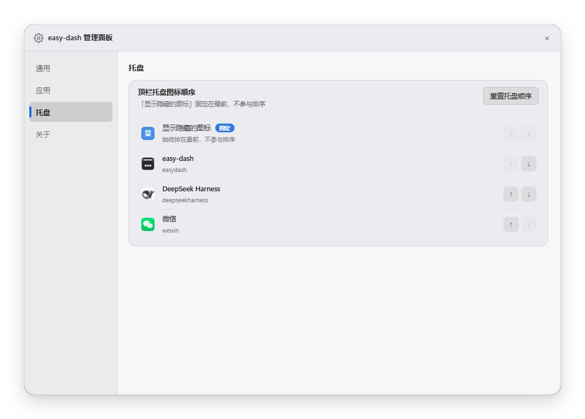
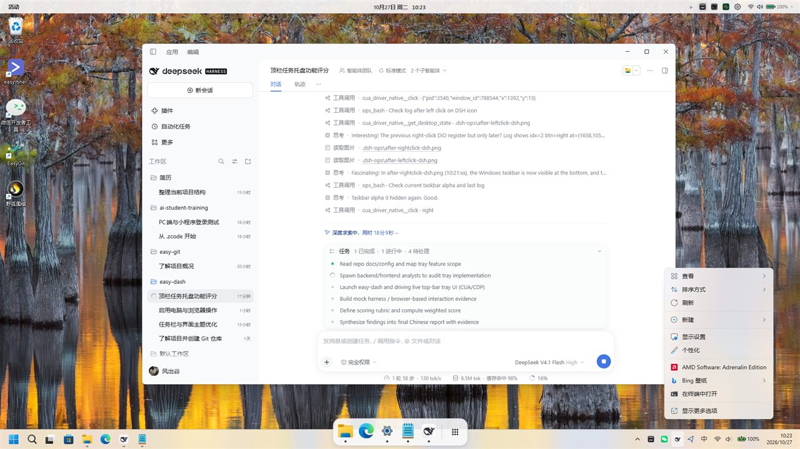
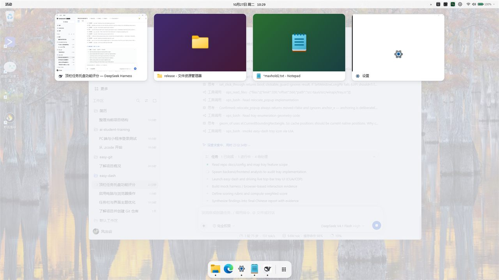
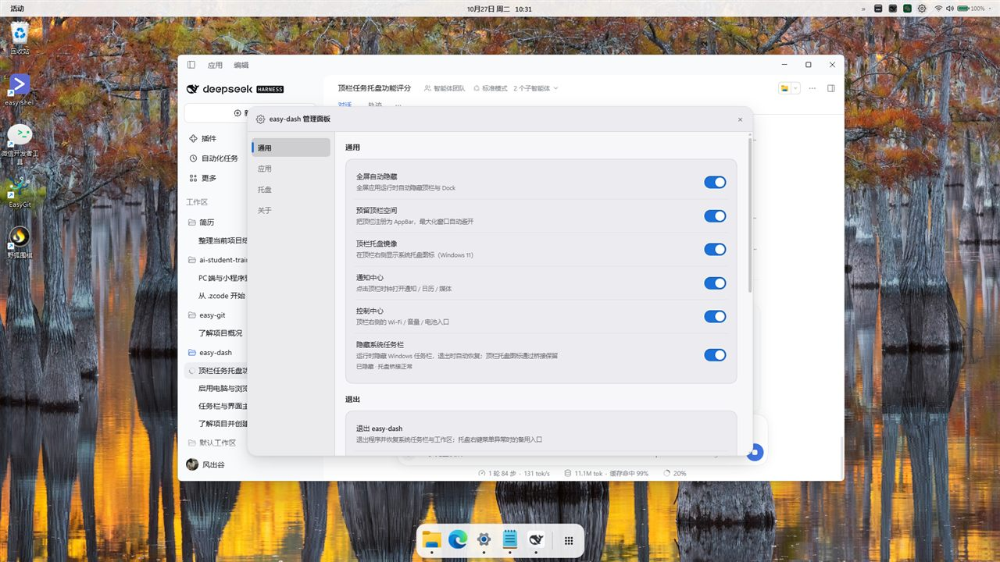

# 顶栏任务托盘（Tray Mirror）功能研究与评分

- 日期：2026-10-27
- 被测对象：`easy-dash 0.2.1` 工作区（HEAD `7b93eee` + 未提交实现，release exe 构建于 09:54）
- 环境：Windows 11 26H2，1920×1080，100% 缩放，单显示器；应用以**管理员权限**运行（清单 `requireAdministrator`）
- 方法：前端/后端源码审计 + 真机运行（CUA 桌面操作、UIA 探针、`tray-click.log` 统计）+ 截图证据
- 结论：**总分 60/100（D+，刚好及格）**。托盘镜像“看得见、排得动、配置得通”，但**点击后的可见反馈与可靠性是当前最大短板**；且 README/CHANGELOG 宣称的“弹窗锚定在顶栏图标下方”在当前实现中已被有意移除。

> **2026-10-27 后续（已实施，重要）**：本报告评审的是旧 UIA 镜像 + 任务栏指针点击实现。当天已完成 **托盘代理窗口** 重写：`src-tauri/src/tray_proxy.rs` 注册伪 `Shell_TrayWnd`、接收 `SHELLTRAYDATA` 并转发真实托盘、点击用 `SendNotifyMessage` 直发应用；不再显示/移动光标点击任务栏。真机（Win11 26H2，管理员进程）验证：代理捕获 9 个图标（含 easy-dash 自身）；微信右键把光标移到顶栏 `(1601,16)`，任务栏保持 `alpha=0`；easy-dash 左键打开活动概览。P0-1/P0-2/P0-3 针对旧实现，保留作历史依据；剩余限制以 README「已知限制」为准。
>
> **2026-10-27 体验修复（同日）**：① 过滤 `explorer.exe` 持有的电量/音量/蓝牙设备等 Shell 图标，避免顶栏托盘与右侧状态区重复；② 浅色主题不再 `brightness` 压暗整张图标（白底图标会变成半透明黑块），改为 `drop-shadow` 描边；③ 右键菜单：修正 `Shell_NotifyIconGetRect` 的倒置矩形，Qt 菜单用 `0x7B` 触发并对新出现/由隐转显的菜单做 1.5s 定位兜底。真机微信菜单从 `(-24,965)` 被移动到 `(1552,32)`，抖音 `LynxContextMenu` 从 `(1713,-192)` 被移动到 `(1713,32)`，均落在顶栏图标下方且可点击。

---

## 1. 一句话结论

> 顶栏托盘镜像已经具备完整的产品骨架（UIA 枚举、真实透明图标、主题修正、拖拽排序、诊断日志、管理面板配置），但核心交互链路仍是「best-effort」：**点击坐标依赖 ≤10s 的旧快照、弹窗锚定未实现、约 3/4 的点击未检测到弹窗（桌面无可见反馈），右键还可能把 Windows 原生任务栏显示出来最长 60 秒**。适合自用尝鲜，不适合作为“等同系统托盘”的日常交互入口。

---

## 2. 功能拆解（当前实际实现）

| 能力 | 状态 | 实现位置 |
| --- | --- | --- |
| 系统托盘图标枚举（Win11 XAML 任务栏 / UIA） | ✅ | `src-tauri/src/winapi/tray.rs:171`（`FindAll` 全树） |
| 顶栏渲染真实透明图标 | ✅ | `ui/js/tray.js:242`、`ui/topbar.html:36` |
| 10s 轮询 + `tray-changed` 事件刷新 | ✅ | `ui/js/tray.js:8,58`；`src-tauri/src/tray_mirror.rs:40` |
| 左键 / 右键转发到原生托盘 | ⚠️ 可用但不稳定 | `ui/js/tray.js:294,311,356`；`src-tauri/src/commands.rs:401` |
| 溢出按钮（»）固定最前 | ✅ | `src-tauri/src/tray_mirror.rs:111-140`；`ui/js/tray.js:249` |
| 拖拽排序 + 持久化 + 管理面板排序列表 | ✅（本次未做真机拖拽） | `ui/js/tray.js:401-613`；`ui/js/manager.js` 托盘页 |
| 深/浅主题图标可见性修正（canvas 采样亮度） | ✅ | `ui/js/tray.js:163-240`；`ui/css/topbar.css:160-172` |
| 管理面板开关（托盘镜像 / 隐藏系统任务栏） | ✅ | `ui/manager.html:102`；`ui/js/manager.js` |
| 点击诊断日志 | ⚠️ 有，但信息不足以定位 | `%APPDATA%\com.easydash.app\tray-click.log`；`src-tauri/src/commands.rs:341-361,502-517` |
| **点击后弹窗锚定到顶栏图标下方** | ❌ **名存实亡** | `src-tauri/src/winapi/tray.rs:635-681`（`_anchor_x` 未使用，恒返回 `moved=false`） |
| 点击失败的用户可见反馈 | ❌ 基本不可见 | `ui/js/tray.js:383-391`（复用 32px 窗口内的 `#tooltip`，被裁剪） |
| 键盘可达性（Tab/回车/键盘排序） | ❌ | 见 §5 P1 |

### 架构/调用链（简化）

```
ui/js/tray.js (10s 轮询 + tray-changed)
   └─ invoke get_tray_items / refresh_tray
        └─ tray_mirror 工作线程 (src-tauri/src/tray_mirror.rs:23)
             ├─ tray::enumerate() ─ UIA FindAll(Shell_TrayWnd, Descendants)
             │    └─ 包在 taskbar::bridged() 里（隐身任务栏 alpha=0 + 临时可点）
             └─ apply_tray_order() → 缓存 + emit("tray-changed")

点击：
ui/js/tray.js:356 clickTray(index,key,anchorX)
   └─ commands::tray_click (commands.rs:401)
        ├─ 按 key 兜底匹配缓存（index 漂移兜底）
        ├─ 后台线程：snapshot_windows → begin_hold(alpha=0)
        ├─ click_at_held(cx,cy,button)  // SetCursorPos + mouse_event
        ├─ relocate_popup()（实际不移动，仅用于判定“有弹窗”）
        ├─ 命中弹窗 → set_hold_alpha(255) 显示任务栏
        └─ 轮询弹窗是否关闭（上限 60s）→ 恢复隐身 → 写 tray-click.log
```

---

## 3. 真机验证记录（2026-10-27 10:06–10:45）

> 说明：应用以管理员权限（High IL）运行，DSH/CUA 守护进程为 Medium IL，UIPI 会拦截键盘/部分注入；本次通过顶栏 WebView 的点击事件 + 应用自身 `tray_click` 日志 + UIA 探针交叉验证。**程序化点击不能完全等价于人工鼠标点击**，故结论同时结合代码与日志。

| # | 动作 | 结果 |
| --- | --- | --- |
| 1 | 启动 release exe（UAC 提权） | 成功；顶栏/Dock 正常，任务栏进入隐身模式（`visible=True, layered=True, transparent=True, alpha=0`） |
| 2 | 观察顶栏托盘区 | 正常渲染 4 项：`»`（溢出）+ easy-dash（黑方块）+ DeepSeek Harness（鲸鱼）+ 微信（绿）；顺序与配置 `trayOrder` 一致（见 `assets/topbar-tray-3x.png`） |
| 3 | 查看管理面板 | 「顶栏托盘镜像」开关存在；「隐藏系统任务栏」显示“已隐藏 · 托盘桥接正常”；「托盘」页列出 4 项并支持 ↑↓ / 重置（见 `assets/manager-tray.png`） |
| 4 | 点击顶栏 easy-dash 镜像图标（左键） | `tray-click.log` 记录 `idx=1 btn=left at=(1566,1056) mode=native popup=- held_ms=1620`；**桌面无任何可见变化**（未出现概览） |
| 5 | 点击顶栏微信镜像图标（左键） | 记录 `idx=3 btn=left at=(1594,1056)`；预计应点到微信图标，但桌面仍无变化 |
| 6 | 右键顶栏 easy-dash 镜像图标 | 记录 `idx=1 btn=right at=(1594,1056) popup=0x61408d4 rect=(1584,1006,282,68) held_ms=60009`；**Windows 任务栏被显示出来并持续 60s**；本次自动化复现中出现的是桌面右键菜单（疑似点击穿透/坐标偏移），不是 easy-dash 托盘菜单（见 `assets/right-click-wrong-menu.jpg`） |
| 7 | 用 UIA 直接 Invoke 原生 easy-dash 托盘图标（对照组） | **活动概览正常打开**（见 `assets/tray-invoke-overview.jpg`）→ 原生托盘图标本身正常，问题在镜像点击链路 |
| 8 | 正常退出（管理面板 → 退出 → 二次确认） | 进程退出；任务栏恢复 `visible=True layered=False exstyle=0x88`，工作区 `(0,0)-(1920,1032)`，marker 删除 ✅ |
| 9 | 会话开始时的桌面状态 | 发现**无 easy-dash 进程、无 marker，但任务栏仍是 alpha=0 + 鼠标穿透的隐身态**（疑似上一个运行实例异常退出/恢复不完整残留）；用非提升脚本直接清 `WS_EX_LAYERED/TRANSPARENT` 后恢复 |

### 3.1 关键对照证据：镜像坐标与原生图标位置不一致

同一运行时段（10:20–10:26）用 UIA 枚举 `Shell_TrayWnd` 的原生按钮（中心 x）：

| 托盘项 | 镜像点击日志中的原生坐标 | UIA 实时原生中心 | 差异 |
| --- | --- | --- | --- |
| easy-dash | 1566 | 1594 | **-28px（约 1 个图标）** |
| DeepSeek Harness | 1626 | 1658 | **-32px** |
| 微信 | 1594 | 1626 | **-32px** |

→ 镜像缓存中的 `x/y` 与窗口可见时的原生布局存在偏移（托盘布局会因“显示隐藏的图标”箭头、输入法指示器等动态出现/消失而整体平移，缓存最长 10s 才刷新，点击前也不重新枚举）。结果是**点 A 应用可能落到相邻图标或空白处**。这也是第 4/5/6 步“无反应/出现桌面菜单”的合理解释。

---

## 4. 日志统计（`tray-click.log`，194 条记录）

| 指标 | 当前 `mode=native`（26 条） | 历史模式（老构建，168 条） |
| --- | --- | --- |
| 右键点击 | 7 次，`popup` 命中 6 次（85.7%） | invisible-mouse 47 次 / 30 命中；visible-mouse 16 / 4；visible-postmsg 12 / 0 |
| 左键点击 | 19 次，`popup` 命中 3 次（15.8%） | invisible-mouse 33 / 0；visible-mouse 30 / 0；visible-postmsg 30 / 6 |
| 弹窗矩形位置 | **全部 y≈965–1006（原生托盘处）**，无一条 y≈40（顶栏下方） | 33 条 y=40（老构建会搬移到顶栏下方） |
| 单次 hold 时长 | 最大 **60009 ms**，另有 23871 / 17693 ms；中位数约 1.6s | — |
| 并发/重复 | 存在同毫秒多条（同一弹窗 3 次连击） | — |

结论：
1. **“锚定”在旧构建中曾实现过（y=40），当前构建已移除**，与 README/CHANGELOG 承诺不符；
2. 右键菜单大多能弹出（6/7），但**显示在屏幕右下角**并伴随任务栏显形；左键点击基本没有可感知反馈；
3. 弹窗一旦被误判为“常驻”，任务栏会保持可见最长 **60 秒**，期间 watchdog 的工作区纠正也被跳过。

---

## 5. 关键问题清单

### P0（直接影响可用性/桌面状态）

| # | 问题 | 证据 | 影响 |
| --- | --- | --- | --- |
| P0-1 | **弹窗锚定未实现但文档宣称已实现** | `src-tauri/src/winapi/tray.rs:635-681`（`_anchor_x` 未使用，注释明确“不搬动任何弹窗”），`README.md:10`、`CHANGELOG.md:60,70` 均宣称“锚定在顶栏图标下方” | 用户按文档预期点托盘，菜单却出现在屏幕右下角；产品承诺与实际行为不一致 |
| P0-2 | **弹窗判定失败/误判时任务栏被显示最长 60s** | `src-tauri/src/commands.rs:337,486-492`；`held_ms=60009` 日志；`src-tauri/src/winapi/taskbar.rs:877-879`（hold 期间 watchdog 直接返回） | 用户会突然看到 Windows 任务栏弹出并停留一分钟；期间工作区纠正停止，可能引发最大化窗口/布局异常 |
| P0-3 | **镜像点击使用 ≤10s 旧坐标，点击前不重新枚举** | `src-tauri/src/commands.rs:449-450,463`；本次实测与 UIA 原生中心相差 28–32px | 托盘图标增减/箭头显隐导致整排位移时，会点到相邻图标或空白（点错应用） |
| P0-4 | **疑似异常退出/恢复不完整会残留“隐身任务栏”，且无 marker 自愈** | 本次会话开始时：无进程、无 `taskbar-hidden.lock`，但 `Shell_TrayWnd` 仍 `alpha=0 + WS_EX_TRANSPARENT`；`restore_all()` 依赖 marker/内存状态（`taskbar.rs:802-860`） | 用户桌面永久失去任务栏，只能重启应用/explorer 或手工改样式；本次已手工恢复 |

### P1（明显体验/质量问题）

| # | 问题 | 证据 |
| --- | --- | --- |
| P1-1 | 点击失败无可见反馈：错误提示复用 `#tooltip`，而顶栏常态仅 32px 高，提示被 `overflow:hidden` 裁剪，且未重新定位 | `ui/js/tray.js:383-391`；`ui/css/shared.css:188-193` |
| P1-2 | 10s 全树 UIA `FindAll` 无 CacheRequest，跨进程逐元素读属性；`tray-changed` 每次携带全量 base64 PNG | `src-tauri/src/winapi/tray.rs:178-247`；`src-tauri/src/tray_mirror.rs:54` |
| P1-3 | 顶栏键盘焦点环失效：`topbar.css` 的 `button:focus{outline:none}` 在 `shared.css` 的 `button:focus-visible` 之后加载且同特异性，覆盖全部顶栏按钮（含托盘按钮） | `ui/css/topbar.css:12-14`；`ui/css/shared.css:219-224`；`ui/topbar.html:18-20` |
| P1-4 | 深色主题 `.tray-dark` 在 `border-box` 下 14px 盒含 2px padding → 图标内容仅 **10px**（常态 16px，缩水 37%）；字母占位色硬编码、白字对比度约 2.9–3.3:1；托盘圆角 6px 与顶栏胶囊不一致；无 `:active` 态 | `ui/css/topbar.css:160-172`；`ui/js/tray.js:17,242-278` |
| P1-5 | 可访问性缺口：`#tray` 无 `role/aria-label`，tooltip 无 `role=tooltip`，错误无 `aria-live`，无键盘排序路径 | `ui/topbar.html:36,59`；`ui/js/tray.js:242-278` |
| P1-6 | 降级不可逆：桥接连续失败 3 次后进入 `PERSISTENT_ALPHA`，此后 `begin_hold` 空 guard、`set_hold_alpha` 早退，菜单永久不可见 | `src-tauri/src/winapi/taskbar.rs:967-1022,1085-1087,1203` |

### P2（代码/诊断/边界）

- 死代码 `click_taskbar_postmessage`（`tray.rs:369`）与 `mode` 字段永远为 `"native"`；相关注释仍在描述三种旧模式（`commands.rs:397-399`、`taskbar.rs:1089-1091`）。
- 日志缺 `key/name/index 对应关系、降级状态、是否被 Dock 遮挡`；超过 64KB 直接删档（`commands.rs:348-352`）。
- `popup_score` 的“topmost 兜底”可能把无关浮层当成弹窗（本次即出现“检测到 282×68 弹窗但用户看到的是桌面菜单”的疑似误判）。
- `pick_overflow` 仅按“最左”猜，输入法指示器属性相同；`order_key` 的 `#0/#1` 依赖枚举顺序；`trayOrder` 无清洗。
- `DockIgnoreGuard` 在等待弹窗前已 drop（`commands.rs:460,467`），always-on-top Dock 可能吞掉菜单点击。

---

## 6. 评分

评分口径：以“是否达到 README 对外承诺”和“日常可用性”为主要标准（100 分制，权重见下）。

| 维度 | 权重 | 得分 | 主要依据 |
| --- | ---: | ---: | --- |
| 功能完整性 | 25 | **20** | 枚举/同步/排序/主题/开关/管理面板齐全；但“弹窗锚定”缺失、tooltip 在常态退化为原生 title、失败反馈不可见 |
| 交互正确性与可靠性 | 25 | **11** | 左键无反馈、右键 60s 显形任务栏、坐标偏移点错图标、约 3/4 点击无 popup、异常退出残留 |
| 视觉与一致性 | 15 | **11** | 真实图标、亮暗适配、布局紧凑；深色垫底缩水至 10px、圆角不统一、溢出箭头用文本字形、字母占位对比度不足 |
| 性能与资源 | 10 | **5** | 10s 全树 UIA、无缓存请求、全量 base64 IPC；每次点击固定约 1.6s 且可能 60s 占用后台线程 |
| 健壮性与边界 | 10 | **5** | Win10/UIA 降级有设计，但降级不可逆、marker 自愈缺口、并发/索引漂移处理不足 |
| 可维护性与可测试性 | 10 | **6** | 模块分层和注释不错；33 个相关单测通过，但 `tray_click`/`relocate_popup`/`popup_score`/并发零覆盖；死代码与注释漂移 |
| 文档与可诊断性 | 5 | **2** | 日志存在但字段不足；README/CHANGELOG 对“锚定”的描述与实现相反 |
| **合计** | **100** | **60** | **D+：可用但不可靠；核心交互需要返工后才能作为日常托盘入口** |

> 评分不确定性约 ±3 分：本次顶栏程序化点击受 UIPI 限制，无法 100% 复现人手点击的完整菜单选择流程；但坐标偏移、锚定缺失、60s 显形、残留任务栏均有代码或日志/截图直接证据。

---

## 7. README / 发布说明的偏差（建议同步修正）

| 文档 | 现状描述 | 实际 |
| --- | --- | --- |
| [`README.md:10`](../../README.md#L10) | “点击后的应用菜单/浮层（含 easy-dash 自身托盘菜单）**锚定在顶栏图标下方**” | 当前实现明确不移动弹窗（`tray.rs:675-680`），日志中全部在原生托盘处（y≈1000） |
| [`README.md:114`](../../README.md#L114) | “弹窗锚定是 best-effort … 不迁移” | 实际是**完全不迁移**，不是“部分不迁移” |
| [`CHANGELOG.md:60,70`](../../CHANGELOG.md#L60) | 宣称锚定/修复右键菜单仍停留原生托盘 | 同上 |
| [`docs/releases/v0.1.0.md:10`](../../docs/releases/v0.1.0.md#L10) | 宣称锚定 | 同上 |

---

## 8. 改进建议（按投入产出排序）

### P0（建议下一个版本必须处理）

1. **点击前实时校准坐标**：`tray_click` 内先 `enumerate()` 一次（或用 UIA 按 `order_key`/名称定位元素并取其 BoundingRectangle），再发指针事件；若点击前后坐标变化，重试一次。验收：托盘图标增减/箭头显隐后连续点击 20 次，命中目标 20/20（日志记录目标 `name`）。
2. **给 hold 设硬上限并保证恢复**：等待弹窗时间从 60s 降到 e.g. 3–5s；任何路径退出前恢复 alpha=0/穿透；hold 期间保留 watchdog 的工作区校正；若检测到 `popup` 但用户 2s 内无操作，恢复隐身。验收：任何点击后 ≤5s 桌面回到无任务栏状态。
3. **锚定二选一**：要么恢复“移动到顶栏下方”（若 Win11 XAML 菜单无法搬移，可考虑自绘菜单/托盘浮层镜像，成本较高），要么立即修正 README/CHANGELOG，把“锚定”改为“原生位置显示（best-effort）”。**不能继续文档说一套、代码做一套。**
4. **残局自愈**：启动时即使无 marker，也检测 `Shell_TrayWnd` 是否 `alpha=0 + WS_EX_TRANSPARENT`，若是则恢复；退出前用 `GetLayeredWindowAttributes` 读回确认。验收：强杀/崩溃/正常退出三种情况下桌面任务栏均可恢复。

### P1（体验）

5. 点击后 800ms 内无可见结果 → 在顶栏下方（或面板展开态）显示 toast，并写入 `tray-click.log`（带 `name/key/degraded`）。
6. 修复顶栏焦点环（`:focus:not(:focus-visible)`），补齐 `#tray role="toolbar" aria-label`、tooltip `aria-describedby`、`aria-live`；管理面板托盘排序补键盘上下移动（已有 ↑↓ 按钮但无快捷键）。
7. 视觉：`.tray-dark` 改为 18px 盒（`content-box` 或 `box-sizing:content-box`）避免 10px 缩水；字母色改用 token 并提高对比度；统一 `--radius-*`；溢出按钮改用 Lucide 图标；补 `:active`。
8. 性能：UIA 扫描加 `CacheRequest`（一次性取 BoundingRectangle/Name/ClassName）；`tray-changed` 仅传变更摘要或图标哈希；托盘不可用/隐藏时降低轮询频率。

### P2（工程化）

9. 删除死代码/统一 `mode` 语义；日志增加 `key/name/degraded/popup_score`，轮转而非删档；`popup_score` 增加“必须是本进程/有 owner/窗口类白名单”的收窄规则。
10. 单测补充：`tray_click` 的 key 兜底、坐标失效重试、`relocate_popup` 策略、hold 生命周期、并发点击串行化；用 mock 的 Win32 层做可重复验证。

---

## 9. 附录

### 9.1 证据截图

**顶栏托盘区域（3× 放大，浅色主题，顺序：» / easy-dash / DeepSeek Harness / 微信）**


**管理面板「托盘」页（溢出箭头固定最前、可 ↑↓ 排序、支持重置）**



**右键镜像图标后：Windows 任务栏显形 + 桌面右键菜单（不是目标应用菜单）**



**对照组：UIA 直接 Invoke 原生 easy-dash 托盘图标 → 活动概览正常打开**



**管理面板「通用」页（顶栏托盘镜像开关 / 隐藏系统任务栏状态）**



### 9.2 复现命令

```powershell
# 查看点击诊断日志
Get-Content "$env:APPDATA\com.easydash.app\tray-click.log" -Tail 30

# 查看任务栏隐身/恢复状态
# （见本次审计脚本思路：FindWindow("Shell_TrayWnd") + GetLayeredWindowAttributes + GetWindowLong(GWL_EXSTYLE)）
```

### 9.3 环境恢复说明

- 会话开始时发现残留隐身任务栏（无进程/无 marker），已手工恢复；
- 真机测试结束后通过管理面板正常退出，验证任务栏/工作区恢复（`visible=True, layered=False, exstyle=0x88, workarea=(0,0)-(1920,1032)`）；
- 测试中误切换的「同时控制系统主题」已改回 `true`；配置未做其他改动。
