# 液态玻璃 2.0 验收记录（2026-10-28）

> 范围：`data-material="liquid"` 的控制中心 / 通知中心 / 顶栏 / Dock / 管理面板 / 活动概览 / 应用中心；
> `solid` / `glow` 回归不变。
> 设计规格：`docs/design-system.md` §3.5 / §3.6 / §4.1 / §4.2 / §4.9 / §6.1 / §7 / §8。

## 1. 实现摘要

| 层 | 实现 |
| --- | --- |
| 面板取样 | `src-tauri/src/winapi/glass.rs` + 命令 `glass_backdrop`；`ClientToScreen` + DPI，480 宽 JPEG q72，返回 `p05/p95/mean` |
| 窗口级取样 | `window_backdrop`（`GetClientRect` + `ClientToScreen`）；`surface_backdrops` 缓存；命令 `surface_backdrop`；事件 `surface-backdrop`；各窗口 `show()` 前取样 |
| 光学公式 | `ui/js/glass-math.js`：sRGB 逐通道合成；暗色 4.7:1 最小色阶 + 密度；**亮色白色阶上限 `.14` + 自适应墨色**；蓝玻璃 alpha `.6–.9` |
| 取样/变量 | `ui/js/glass.js`：`.panel` / surface 内联 `--lg-backdrop/--lg-grade/--lg-accent-alpha/--lg-shadow`，主题切换只重算、材质切回复用 |
| 面板打开流程 | `ui/js/panels.js`：`.lg-wait`（不可见 + animation:none）→ 32px 窗口下测量/截屏 → 拉高窗口 → 等视口长高 → 揭示；`openToken` 防竞态 |
| 面板样式 | `ui/css/materials.css` §7：`::before` 玻璃体（inset -40、blur 30 / saturate 1.5）→ `::after` 镜面层（噪点 + 1px 镜面线 + 多重 inset rim）→ `.lg-edge` 折射层 → 同色系三段投影；去 1px border + padding 补偿 |
| 全部 surface 样式 | `ui/css/materials.css` §8：顶栏 18px / Dock 24px / 管理面板 30px；顶栏 `clip-path: inset(40px)`、Dock 圆角 `clip-path`；概览/应用中心 `#backdrop` 全屏玻璃体 + scrim；卡片/搜索条低 alpha + 发丝边；管理面板开关蓝玻璃 |
| 折射 | `ui/topbar.html` 内联 `#lg-refract` / `#lg-refract-edge`；Dock/管理面板由 `glass.js` 注入；入场后加 `.lg-refract` |
| 回归脚本 | `scripts/check-glass.mjs` + `npm run check:glass` |

## 2. 验证结果

- Rust：`cargo check --all-targets` → 0 warning；`cargo build --release` + `tauri build` 成功（09:02 的 release / NSIS 安装包）。
  `cargo test --lib` 在当前 DSH shell 下 **149 passed / 1 failed / 13 ignored**：失败的是
  `winapi::imports::tests::validate_rejects_disallowed_extension`，`File::create` 在 shell 的 `TEMP=/tmp`
  下被 Windows 拒绝（PermissionDenied，环境权限，不是本次 UI 改动）；正常 Windows 临时目录下此前为 150 passed。
- 真实桌面取样冒烟（`smoke_glass_backdrop`，ignored）：截 420×604 → 非黑（近黑 3.9%），
  `mean=[32,34,35]`、`p05=0.002`、`p95=0.269`；PNG 见 `src-tauri/target/tmp/glass-smoke.png`。
  本次截到的是深色电影画面（人物 + 暖色高光），验证暗部场景与共享 `capture_rect` 管线。
- 光学矩阵：`npm run check:glass` 全绿（两主题 × 背景亮度 0–1 + 高反差组合；暗色墨色 ≥4.5、亮色自适应墨色 ≥3.9、
  亮色白色阶 ≤.14、蓝玻璃白字 ≥3.5、阴影无纯黑）。亮色最差点在 p05=.10，墨色对比 4.12:1（`light` 墨色 + `.14` 白）。
- 面板打开流程 harness（真实 `panels.js` + `glass.js` + 后端真实截屏）：
  - 视口 32px（模拟顶栏常态）时面板 `glass_backdrop` 矩形 = `{x:1492, y:40, width:420, height:604}`（1920 宽）；
    1280 宽复跑 = `{x:852, y:40, width:420, height:604}`，均为右边距 8px。
    （顶栏启动补截会额外调用一次 `{0,0,width,32}`，所以 harness 的最后一个 `captureArgs` 是顶栏条；面板矩形看 `captureRect`。）
  - 结束后 `data-glass=live`、`--lg-backdrop` 为 JPEG data URL、`.lg-edge` 存在、`resize_topbar(688)` 被调用、无 `.lg-wait` 残留。
  - 控制中心 `scrollHeight === clientHeight === 541`（无滚动条）；面板 420×604。
  - 主题切换 → 只重算色阶（captures +0）；切 solid → `data-glass=off` / `.lg-refract` 移除；切回 liquid → 复用缓存、`.lg-backdrop` 保留。
  - 强制 `glass_backdrop` 返回 null → `data-glass=fallback`、无 backdrop、色阶 `.72`、fallback 霞光生效，面板正常揭示。
  - 浅色复跑（`qa-flow.html?t=light`，亮底图）：色阶 `.100`、`data-ink="dark"`，`scrollHeight === clientHeight === 541`；
    面板几乎全透、壁纸清晰，文字深色可读。
- **surface 事件 / 主题**（真实 `topbar.html` + `glass.js`，mock `__TAURI__`、无缓存）：
  - 命令 null → `data-glass=fallback`、色阶 `.72`；手动 emit `surface-backdrop` → `live`、色阶 `.540`、`--lg-blur=18px`。
  - emit `theme-changed` light → `data-theme=light`、色阶 `.14`（暗底图 → `data-ink="light"`），无重新截屏；回 dark → `.540`。
  - 材质切 solid → topbar 恢复 `.88` 底 + 1px border、无 `::before`；切回 liquid → 透明底、`border:0`、`blur(18px) saturate(1.5)`、`::before` 恢复。
- **surface 材质切换补截**（真实 `topbar.html`，启动 `material=solid`、`surface_backdrop` 返回 null）：
  - solid 下 `data-glass=fallback`、`rgba(24,25,29,.88)` 底、1px border、无 `::before`。
  - emit `theme-changed` liquid → `glass_backdrop({x:0,y:0,width:1280,height:32})`，
    调用瞬间 `.lg-wait` 存在且 `visibility:hidden`（窗口透明，截到桌面）；随后 `live`、透明底、`border:0`、
    `blur(18px) saturate(1.5)`、底图写入，`.lg-wait` 已移除。
  - 自动取样也加 `config.material == "liquid"` 守卫：solid/glow 显示窗口时不后台截屏；概览/应用中心下次打开补。
- **顶栏启动补截**（AppBar 预留 / 最大化窗口重排之后）：
  - 页面就绪后 `refreshSurface` 完成，`glass.js` 对 topbar 再调一次 `glass_backdrop({x:0,y:0,width:1280,height:32})`；
    调用瞬间 `.lg-wait` + `visibility:hidden`，随后 `data-glass=live`、底片替换为预留后的桌面，无 `.lg-wait` 残留。
  - 这条路径只在 liquid 下执行；solid/glow 不取样，切 liquid 时走上面的补截分支。
- **surface 视觉 harness**（真实页面 CSS/JS + mock Tauri + 一张底图；1280×720）：
  - 顶栏：`topbar lg-surface lg-topbar`，`live`，`--lg-grade` dark `.549` / light `.14` + `data-ink="light"`（暗底图），
    `--lg-blur:18px`，`::before { filter: blur(18px) saturate(1.5); clip-path: inset(40px) }`，无 border。
  - Dock：`dock lg-surface lg-dock lg-refract`，`live`，`24px`，`clip-path: inset(40px round 24px)`，
    `filter: blur(24px) saturate(1.5) url("#lg-refract")`，4 个图标；图标放大不被圆角裁切。
  - 管理面板：`mp-panel lg-surface lg-manager lg-refract`，`live`，`30px`，`lg-edge` 存在；
    深色 `.549`；浅色暗底图 `.14` + `data-ink="light"`（深色标题栏/卡片 + 浅色字）；浅色亮底图 `.100` + `data-ink="dark"`
    （浅色玻璃 + 深色字）。两套截图里标题栏、侧栏、卡片层级清楚，开关是蓝玻璃。
  - 活动概览：`#backdrop.lg-overlay`，`live`，6 张卡片，卡片 `rgba(255,255,255,.05)` + 同色系投影 + 发丝边，
    全屏 `::before` 30px 模糊，scrim 下能看出壁纸。浅色 + 暗底图时 `data-ink="light"`、卡片/提示/标题全部切浅色字。
  - 应用中心：`#backdrop.lg-overlay`，12 个应用；搜索条 `rgba(255,255,255,.05)` + 同色系投影；应用名在 scrim 上可读。
- **浅色去白底（v0.5.1）**：
  - 亮色 `--lg-grade` 从 `.55` 降到 `.14` 上限 / 常规 `.10`，`--lg-tint .06→.04`，`--surface-2 .16→.06`、
    `--surface-inset .35→.12`；管理面板/顶栏/概览/CC 的白色底明显退掉。
  - 暗底图：合成偏暗 → `data-ink="light"`，`shared.css` 暗色 token 块 + `materials.css` 液态暗色 token 块对该子树生效，
    `--text #f2f3f5`、`--surface-2 rgba(255,255,255,.05)`、`--surface-inset rgba(6,7,11,.28)`；截图里是深色透明玻璃 + 浅色字。
  - 亮底图：`data-ink="dark"`，亮色 token 保持；截图里是几乎全透的浅玻璃 + 深色字，壁纸清晰可见。
  - `npm run check:glass` 的亮色阈值调整为 ≥3.9（中间亮度黑白墨色的物理下限约 4.0），亮色白色阶 ≤.14；
    实测 p05=.10 时 4.12:1，是亮色 + 自适应墨色的最差点。
- **真实桌面（2026-10-29 08:46，light + liquid，1920×1080，用户会话）**：
  - 控制中心 / 通知中心（`glass_backdrop` 取样）：面板已是灰色透明玻璃，CC 的卡片/分段/蓝磁贴、NC 的
    通知卡/日历/媒体卡都能透出壁纸；说明新 CSS/JS 与新光学已生效，浅色不再是 `.55` 白底。
  - Dock：仍在 `.55` 白。取样：Dock 顶部内边距 `(170,176,140)`，同屏草地 `(75,80,28)`；`.55` 白合成 ≈`(174,176,153)`，
    与实测吻合；新的 `.10` 取样应为深绿 ~`(93,98,50)`。结论：Dock 的窗口级 `surface_backdrop` 首帧没有拿到/拿到旧位置，
    走了兜底，而不是 CSS 没更新。
  - 修复：`dock.js` 在 `show_dock` 返回后 `easydash:dock-shown` → `glass.js` 隐藏 Dock 一拍用 `glass_backdrop` 按最终
    矩形补截；管理面板 / 概览 / 应用中心在 `manager-open` / `overview-data` / `app-center-open` 后同样补截。
    `window_backdrop` 保留为快速路径，但不再是唯一来源。
  - 资源缓存：前一次真实截图（08:25）仍是 v0.4 `.55` 白，原因是 WebView2 磁盘缓存了旧 `ui/css/js`；清空
    `%LOCALAPPDATA%\\com.easydash.app\\EBWebView`（已备份）后 CC/NC 立即变透明。所有 WebView2 窗口已加
    `--disable-http-cache`，避免升级后再次加载旧样式。
  - **打开活动后顶栏/Dock 跟着窗口变色**（09:13 复现）：活动概览打开 / Dock autohide 重显时，
    `show_if_hidden` / `show_dock_window` 会重新截屏；此时屏幕上已经是概览和窗口缩略图，
    顶栏/Dock 的底片就被换成概览/窗口的颜色，并且一直保留。修复：`surface_backdrops` 里已有该 label
    的底片时直接复用、不再截屏（顶栏/Dock 常驻）；`force=true` 只留给管理面板/概览/应用中心这类临时浮层。
    这样顶栏/Dock 的底片固定在启动/新显示器那一次，不会随活动或窗口颜色变。
  - 证据：`liquid-real-light-before-activity.png` / `liquid-real-light-after-activity.png` 是同一桌面打开活动前后的对照。
- `solid` / `glow` 计算样式回归：solid 仍是 1px border + `--surface-1` + `::before` 1px 顶线 + `::after` none；
  glow 仍是 `.84/.78` 底 + 1px 顶线 + 噪点 z2/overlay。liquid 才是透明的 `::before/::after` 四层。
- `.lg-edge` 基础定位回归：solid 下空 span 仍是 `position:absolute; inset:0`，不作为 flex 项参与布局。

## 3. 证据

- 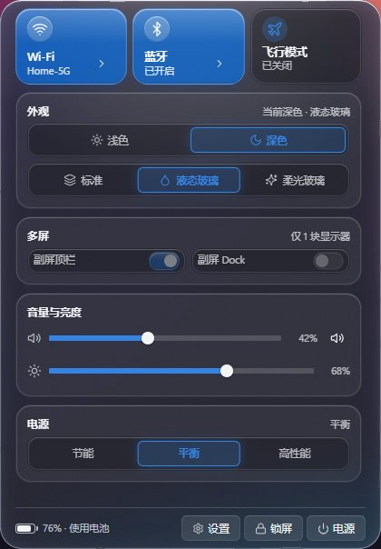
- 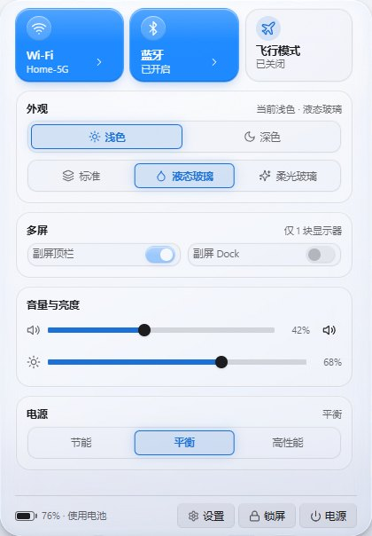
- 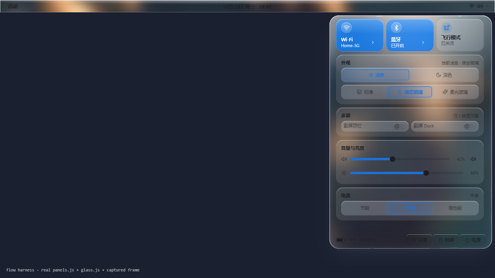
- 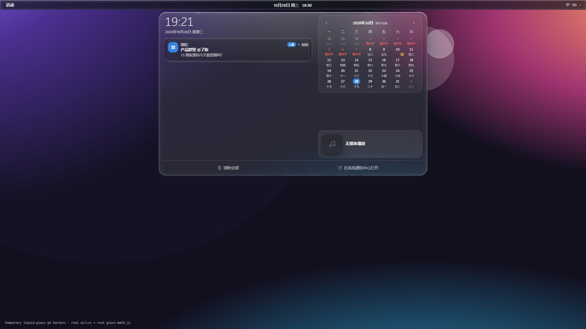
- 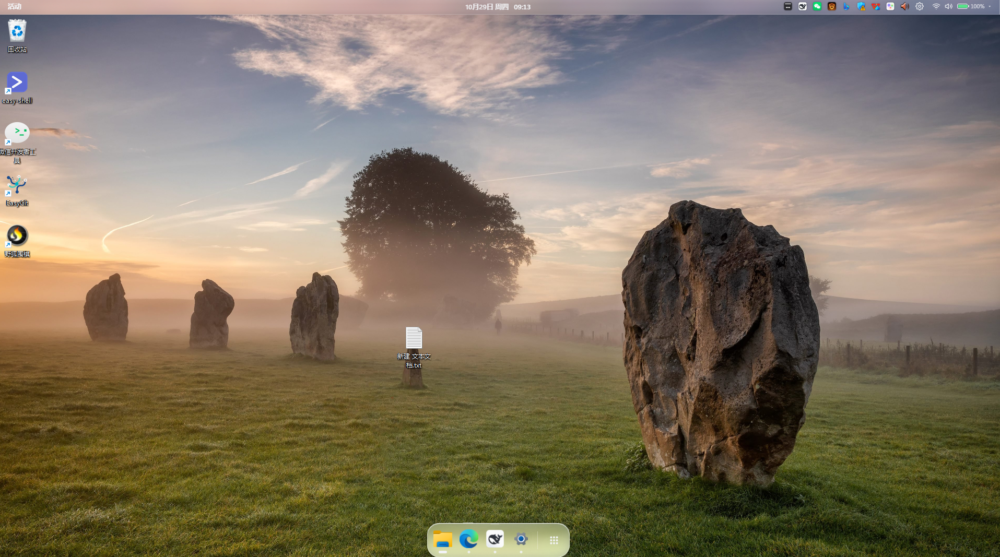
- 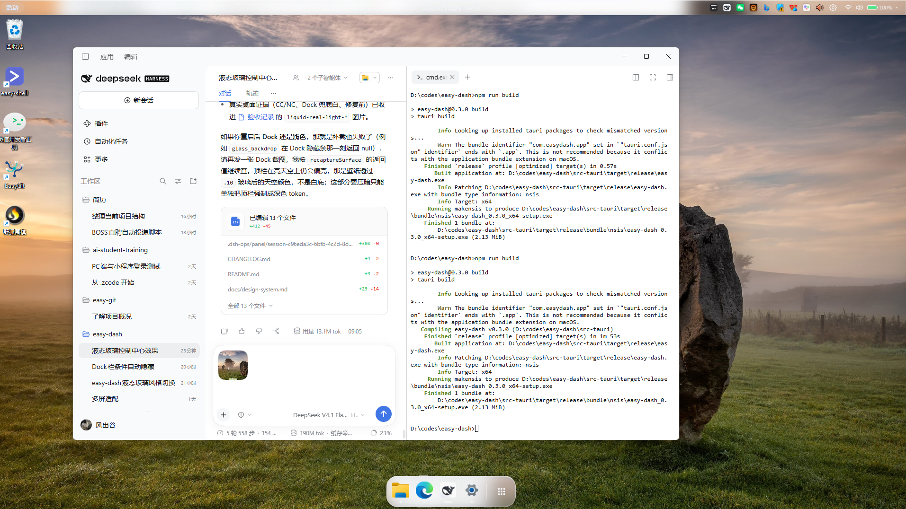
- 
- 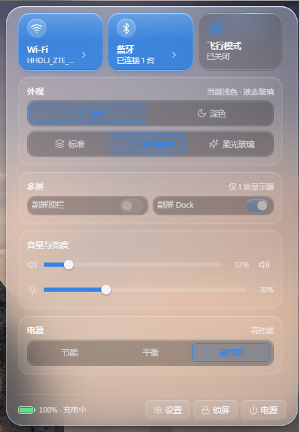
- 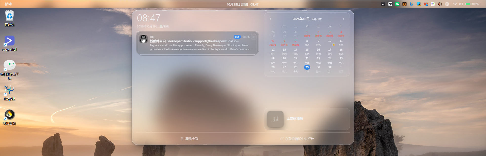
- 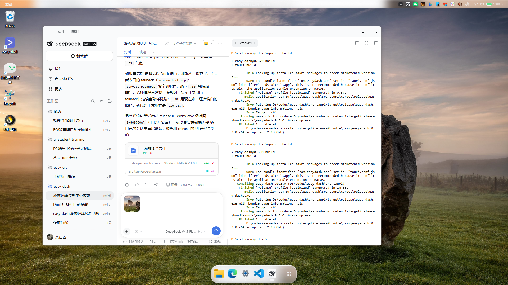
- 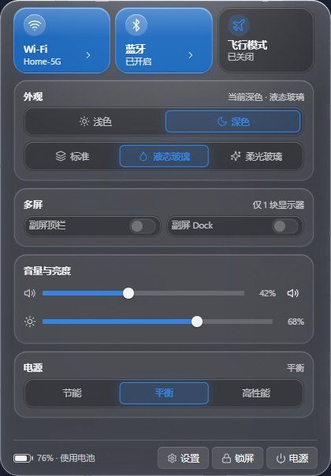
- 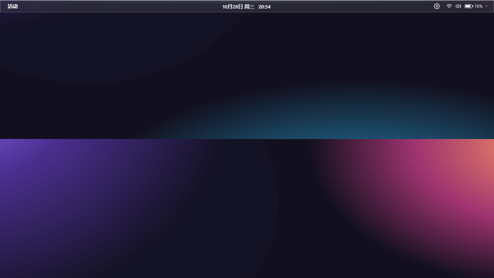
- 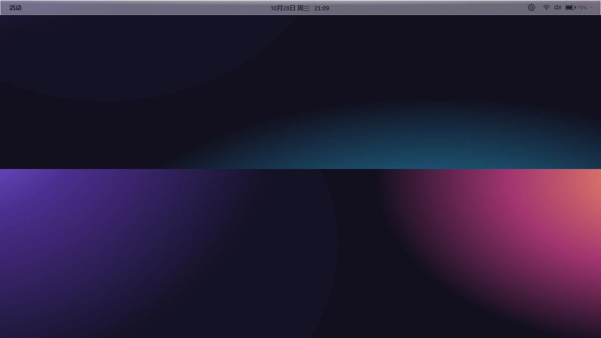
- 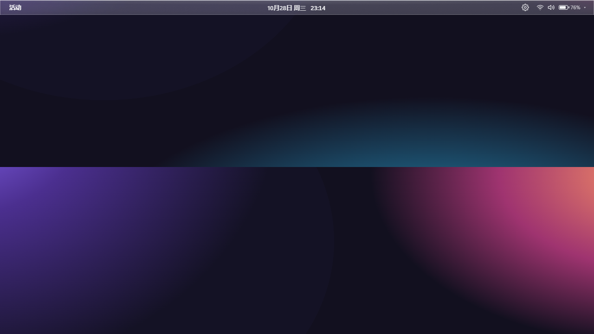
- 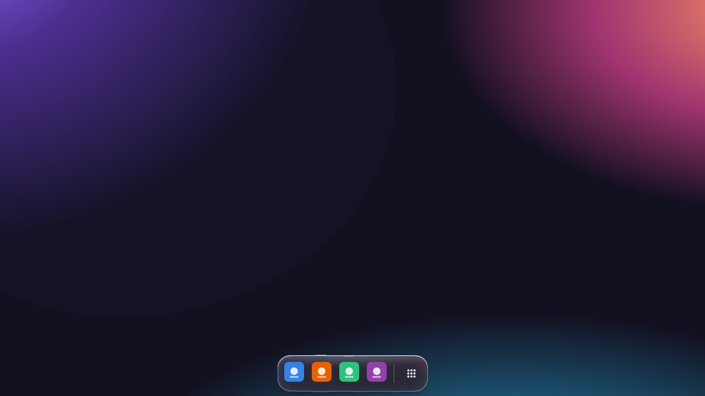
- 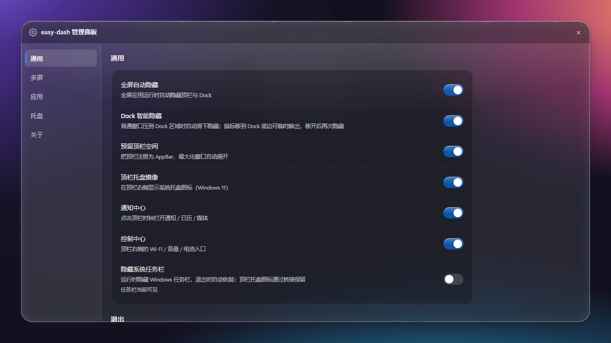
- 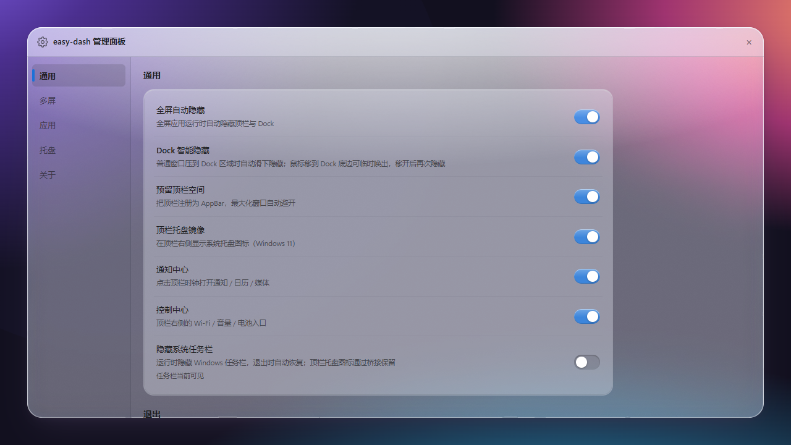
- 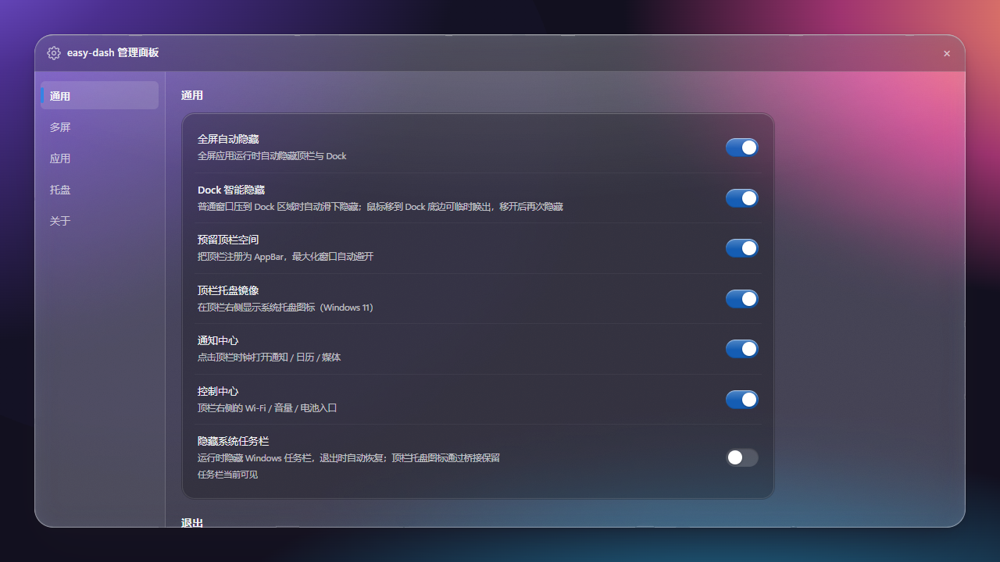
- 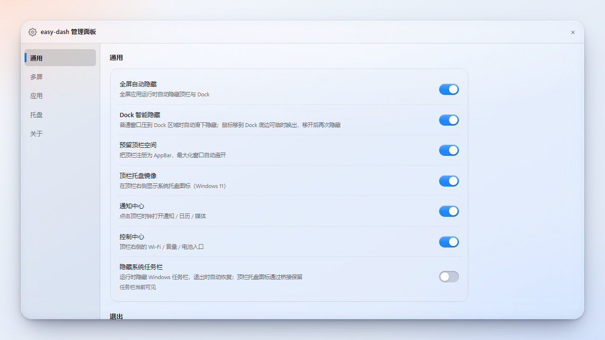
- 
- 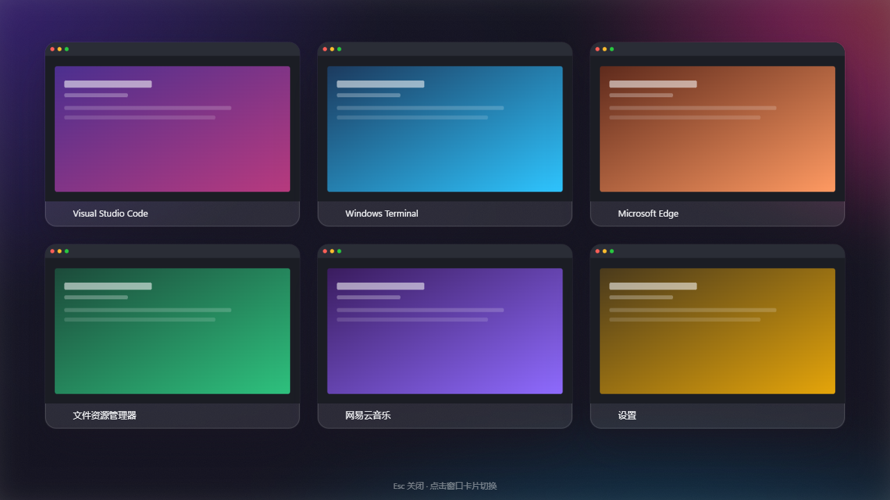
- 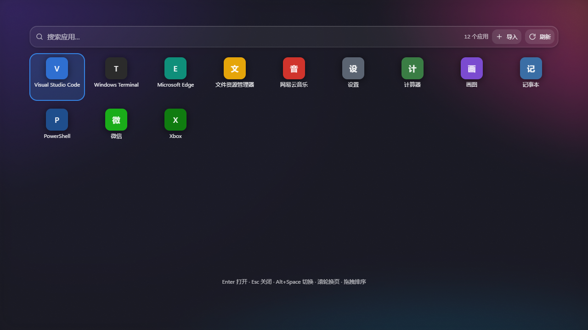

## 4. 环境限制 / 未完成项

- **真实桌面已由用户会话补充**（2026-10-29 08:46，light+liquid，1920×1080）：CC/NC 的 `glass_backdrop`
  面板取样、蓝磁贴、通知卡/日历/媒体卡都已在真实桌面验证；同时暴露出 Dock 的窗口级首帧取样失败。
  已加 Dock 的 `show_dock` 后事件补截与管理面板/概览/应用中心的打开后补截；**待用新构建复验 Dock 压在
  绿草地时是否为绿色透明玻璃**（当前截图是修复前）。
- 当前 DSH 会话**非提升**，启动 release 时 WebView2 仍在 `setup` 阶段返回 `0x800700AA`；上面的真实截图
  来自用户自己的会话。因此「真实顶栏窗口 → 点击控制中心 → 实时桌面」由用户截图覆盖；本会话仍用 harness 复验参数。
- `window_backdrop` 的 Win32 取矩形（`GetClientRect` + `ClientToScreen`）在真实桌面已观察到 Dock 首帧取不到；
  修复改为 `glass_backdrop` 打开后补截。顶栏 32px 条、Dock 窗口、管理面板客户区三种矩形仍建议在提升终端逐一复验。
- 下一次运行新构建后，仍需按 `docs/design-system.md` §8 补：
  换壁纸重开面板、亮/暗 × 白/黑/彩色壁纸截图、多屏/DPI、真实 Esc / 外部点击关闭、solid/glow 截图 diff；
  **Dock / 管理面板 / 概览 / 应用中心的补截是否跟随最终位置/尺寸**、顶栏/Dock 启动取样不能包含自身；
  概览/应用中心每次打开底图跟随壁纸。WebView2 缓存已清并加 `--disable-http-cache`，升级后不再复用旧 CSS。
- 已知限制：取样是一次性的（不逐帧实时模糊）；顶栏/Dock 只在自己的 `show` 前截一张，可见期间换壁纸/移动窗口不会实时更新，
  下次 show / 重启刷新。暗色 + 纯白壁纸色阶到 ~.86；
  **亮色去白底后**白色阶最多 `.14`，暗壁纸会自动切深色玻璃 + 浅色字；中间亮度壁纸的黑/白墨色最大对比度 4.12:1
  （验收线 3.9），这是用户要求「非常透明」后的物理折中，详见 `design-system.md` §6.1。
  蓝玻璃在亮色纯白壁纸下按 3.5:1 折中；打开面板多 20–40ms（超时 220ms 回落）；
  全屏概览/应用中心的窗口级截屏会包含当时可见的顶栏/Dock（糊在背景里，属预期）。
