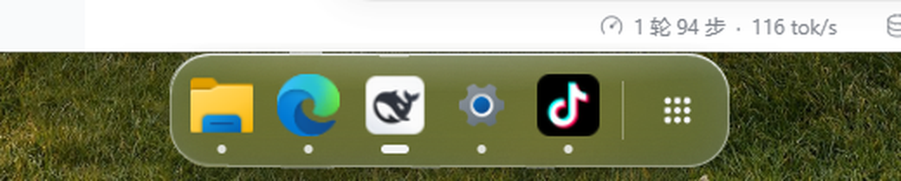

# 微信截屏后 Dock 缩成屏幕底部小方块 —— 定位与修复

- 日期：2026-10-29
- 现象：用微信截屏（`Alt+A`）之后，Dock 显示异常：整条玻璃栏消失，屏幕底部中央只剩一个
  ≈20×14 的小方块；顶栏正常。用户描述为「位置或尺寸不对、只剩一条」，重启 easy-dash 才恢复。
- 结论：Dock 页面的**全屏隐藏状态类**与 `shared.css` 的全局工具类 `.hidden{display:none!important}`
  撞名，全屏期间 body 失去布局 → `syncSize()` 量出 0 → `resize_dock(20,14)` 把 Dock 真窗口缩小。
  已修复前端状态类 + 尺寸守卫，并在 Rust 侧加兜底。

## 1. 现象证据（用户截图）

用户截图是微信截屏保存的 1920×1032 图（截取区域 y=48..1080）。底部中央有一个 20×14 的小方块，
里面一个白点——按坐标还原正是 Dock 窗口被缩小后的位置（居中贴底），白点是被裁掉的 Dock 内容：


（原图裁剪 `(900,990)-(1020,1032)` 8× 放大。）

## 2. 复现（真机，同一台机器）

微信在运行，用 `keybd_event` 发 `Alt+A` 打开微信截图浮层，再 `Esc` 收起；期间用独立探针
（`EnumWindows` + `GetWindowRect`/`DwmGetWindowAttribute`）按 0.4s / 1s / 3s 采样
easy-dash 的 `easy-dash dock` 窗口矩形。

修复前（旧构建）：

```
DURING-SHOT fg=Weixin Qt51514QWindowIcon 0,0,1920,1080     # 截图浮层 = 全屏
Esc 后 0.4s：dock rect 950,1066,970,1080                 # ← 20×14！直到下一次 render 才恢复
```

修复后（本次构建）：

```
DURING-SHOT fg=Weixin Qt51514QWindowIcon 0,0,1920,1080
dock rect 743,1000,1176,1080                             # 433×80，保持正常
Esc 后 0.4s / 1s / 3s：768,1000,1151,1080                # 383×80，位置不变
```

修复后桌面截图（Dock 玻璃条正常）：



## 3. 根因链

1. 微信截图浮层是 `Qt51514QWindowIcon`、`WS_EX_TOPMOST`、`0,0,1920,1080` 的全屏窗口；
   `winapi::fullscreen::foreground_fullscreen_monitor()` 判定为全屏 →
   `surfaces::emit_fullscreen_states()` 给 Dock 发 `fullscreen-changed=true`。
2. `ui/js/dock.js` 收到后 `document.body.classList.add("hidden")`。
3. 但 `ui/css/shared.css` 有全局工具类：

   ```css
   .hidden { display: none !important; }
   ```

   它命中 `<body>`，整页 `display:none`；`#dock` 的 `scrollWidth` / `offsetHeight` 全为 0。
4. 全屏期间 `windows-changed`（截图浮层本身就是一个新窗口）仍会触发 `render()`，而 `render()` 末尾调
   `syncSize()`：

   ```js
   const w = Math.ceil(dockEl.scrollWidth) + 20;   // 0 + 20
   const h = Math.ceil(dockEl.offsetHeight) + 14; // 0 + 14
   invoke("resize_dock", { width: w, height: h });
   ```

   → Rust `surfaces::resize_dock_window()` 把 Dock 窗口 `SetWindowPos` 成 **20×14**，居中贴底。
5. `Esc` 之后只移除 body 类、没有再次量尺寸；如果此时没有新的 `windows-changed`，窗口就永久停在
   20×14（重启 `syncSize(true)` 才恢复）。竞态是否踩中取决于「`fullscreen-changed=false` 与
   `windows-changed` 的到达顺序」，所以是偶发。

## 4. 修复

| 层 | 改动 |
| --- | --- |
| CSS | `body.hidden` → `body.fs-hidden`（`dock.css` / `topbar.css`），全屏只做 `translateY`+`opacity`，页面保持布局 |
| JS | `dock.js` / `topbar.js` 的全屏状态类同步改名；`dock.js::syncSize()` 加布局守卫（`getClientRects()` 为空或算出 <60×40 直接跳过）；`fullscreen-changed=false` / `visibilitychange` 恢复时强制 `syncSize(true)` 自愈 |
| Rust | `surfaces::resize_dock_window()` 增加 `dock_size_is_sane()`（<60×40 或非有限值直接丢弃），并加单测 `degenerate_dock_sizes_are_rejected` |

阈值依据：Dock 正常最小内容（只剩九点格按钮）≈82×70，60×40 不会误伤；20×14 这类尺寸只可能来自
「布局未就绪」。

## 5. 回归验证

- `cargo test --lib` → **159 passed / 0 failed / 14 ignored**（新增 `degenerate_dock_sizes_are_rejected`）。
- `node --check ui/js/dock.js`、`node --check ui/js/topbar.js` 通过。
- 真机：微信 `Alt+A` 浮层期间 Dock 保持 `433×80`；`Esc` 后 0.3s/1s/3s 恒为 `383×80`，
  桌面截图确认玻璃条与图标正常（见上图）。
- 全屏隐藏仍然生效：期间 Dock 窗口保持尺寸、只做 `translateY(140%)`；顶栏 `translateY(-100%)`，
  退出全屏恢复。
